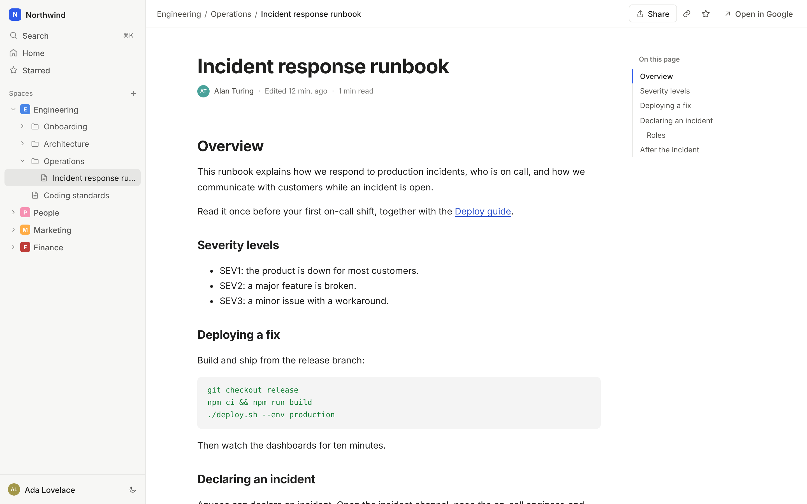
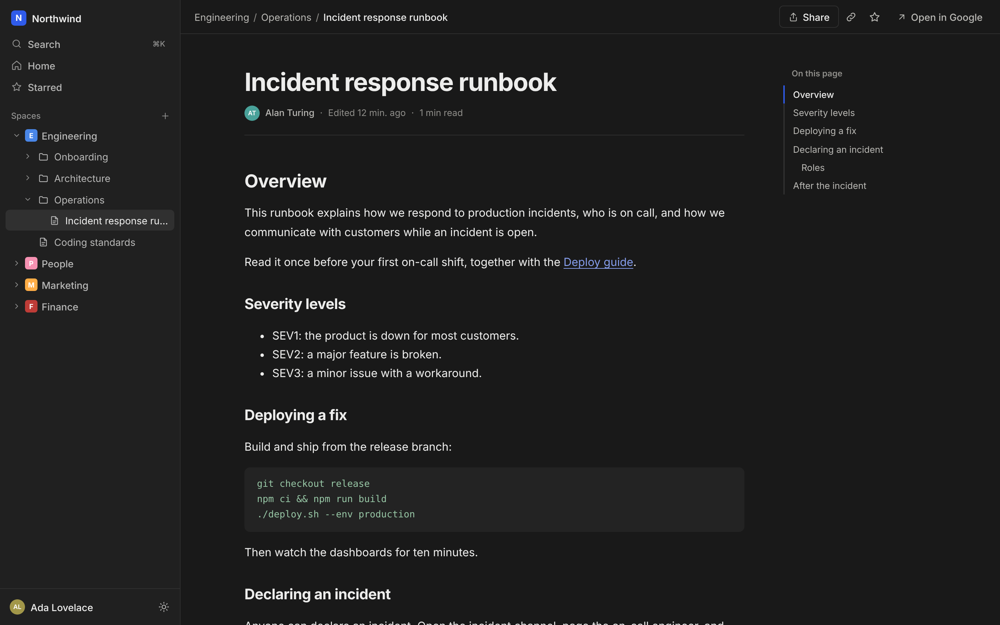
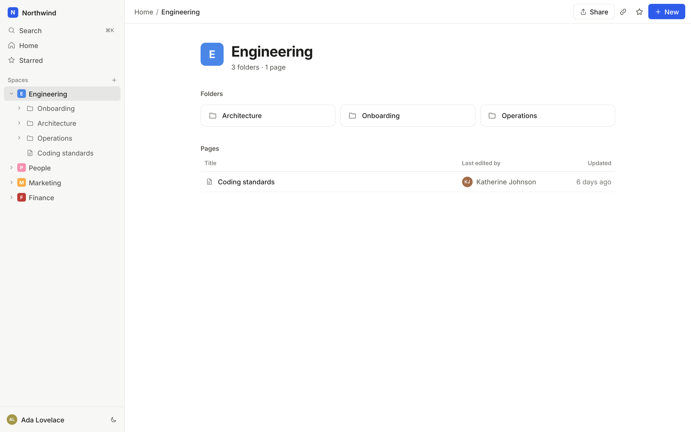
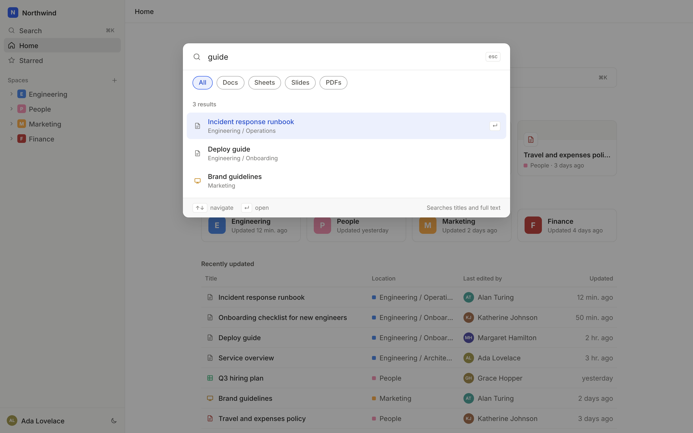
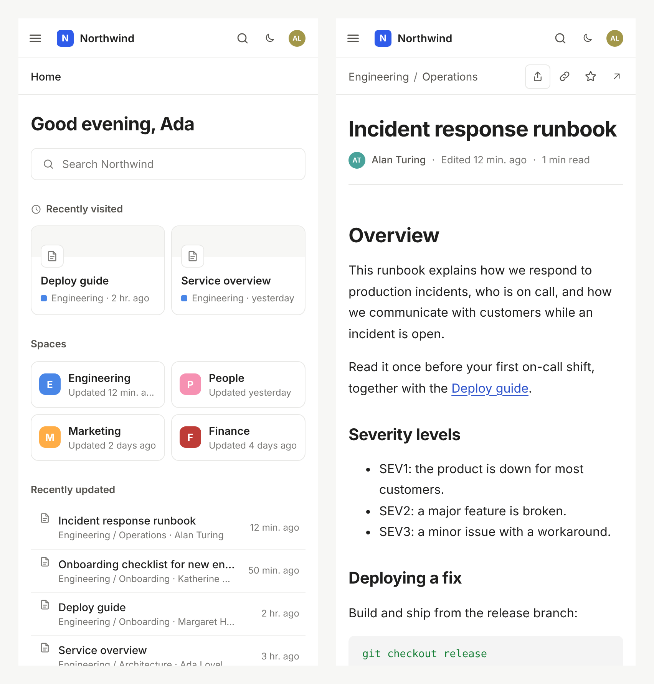

# gwiki

A white-label wiki on top of a Google Shared Drive, or any folder in Google Drive. Folders become sections, Google Docs render as pages, and everything else (PDFs, Sheets, Slides, images, video) opens in Google's own viewer. Access is whatever Google Drive already says it is: there is no database and no backend.

- **Browse** the drive as a folder tree with breadcrumbs.
- **Read** Google Docs as clean pages with an outline; links between Docs stay inside the wiki.
- **Search** names and full text from anywhere with ⌘K, filtered by type, driven by the keyboard.
- **Star** pages; stars follow the user's Google account across devices.
- **Brand it** with one `config.json`: name, logo, colours, fonts, copy, domain.

<p align="center">
  
  
</p>

## Screenshots

| A page with its outline | The same page in dark mode |
| --- | --- |
|  |  |
| **A space** | **Search (⌘K)** |
|  |  |

<p align="center">
  
</p>

Screenshots use made-up demo content.

## Stack

React 19 + TypeScript, built with Vite, with a small hand-built design system (plain CSS and design tokens, no UI framework) laid out like the knowledge bases people already know: a global search bar, a space and page tree, breadcrumbs, bylines and an outline and TanStack Query for fetching and caching. The UI was designed in Claude Design first. The build output is static files, so it can be served from any CDN and scales with it; each user's browser talks to Google directly with their own token, so Drive quotas are per user.

Google APIs used (all official, all called from the browser):

| What | Endpoint |
| --- | --- |
| Sign-in | Google Identity Services token model (`accounts.google.com/gsi/client`) |
| Profile and domain check | `GET https://openidconnect.googleapis.com/v1/userinfo` |
| Wiki name | `GET /drive/v3/drives/{driveId}`, or `files/{folderId}` for a folder root |
| Folder tree (one paged query), listings, recent, search | `GET /drive/v3/files` with `corpora=drive&driveId=…` (or `corpora=user` for a folder root) |
| Page metadata | `GET /drive/v3/files/{id}` |
| Doc content | `GET /drive/v3/files/{id}/export?mimeType=text/html` |
| Stars | `appDataFolder` via `/drive/v3/files` and `/upload/drive/v3/files` |

## Set up Google Cloud (once)

1. In [Google Cloud Console](https://console.cloud.google.com/), create or pick a project and enable the **Google Drive API**.
2. Under **OAuth consent screen**, choose **Internal** for a Workspace organisation, or **External** for a personal Google account (then add yourself under **Test users**), and add the scopes `openid`, `email`, `profile`, `drive.readonly`, `drive.appdata`, and `drive` if you turn on `editing`.
3. Under **Credentials → Create credentials → OAuth client ID**, choose **Web application** and add every origin the wiki is served from (for example `http://localhost:3000` and `https://wiki.example.com`) to **Authorized JavaScript origins**.
4. Copy the client id.
5. Open the Shared Drive, or the folder you want as the wiki's root, and copy its id from the URL: `https://drive.google.com/drive/folders/<id>`.

## Configure

Copy `public/config.example.json` to `public/config.json` and fill it in. That file is git-ignored, so no organisation's client ID or drive ever lands in the repo; in a deployment it is the `config.json` next to `index.html`. It is read at startup, so one build serves any number of organisations, and nothing brand-specific lives in the code.

| Key | Required | Example | Notes |
| --- | --- | --- | --- |
| `googleClientId` | yes | `123-abc.apps.googleusercontent.com` | From step 4. |
| `sharedDriveId` | one of these two | `0AbCdEf…` | A Shared Drive id, from step 5. |
| `rootFolderId` | one of these two | `1XyZ…` | Any folder id instead, from step 5. Works with personal Google accounts, which have no Shared Drives. |
| `appName` | no | `Northwind` | Sidebar, sign-in and tab title. |
| `logoUrl` | no | `/logo.svg` | Replaces the monogram. Put the file in `public/`. |
| `faviconUrl` | no | `/favicon.png` | Replaces the neutral default icon. |
| `allowedDomain` | no | `northwind.com` | Only accounts from this Workspace domain can sign in. |
| `supportUrl` | no | `https://…` | Adds a Help link. |
| `editing` | no | `true` | Lets people add pages and folders from the app. Sign-in then also asks for Drive edit access (the `drive` scope); anyone who declines it keeps a read-only wiki. Writing still happens in Google Docs. |
| `templatesFolderId` | no | `1AbC…` | A folder of Google Docs offered as templates for new pages. Keep it outside the wiki's root so templates don't show up as pages. |
| `staleAfterDays` | no | `180` | Pages not edited for this many days get a "May be out of date" badge. `0` turns it off. |
| `themeDark` | no | `{ "canvas": "#101010" }` | Tokens for dark mode, over the built-in dark palette. Readers pick Light, Dark or System in the account menu. |
| `fontsUrl` | no | Google Fonts `css2` URL | Loads the faces named in `theme`. |
| `theme` | no | `{ "accent": "#0F7B6C" }` | Design tokens, below. |
| `messages` | no | `{ "navHome": "Start" }` | Any UI copy; see `src/messages.ts` for every key. Also how you translate the wiki. |

Theme tokens (all optional; defaults are in `src/styles.css`): `accent`, `accentContrast`, `ink`, `inkMuted`, `inkSubtle`, `canvas` (the backdrop around each page), `surface` (the page itself), `sidebar`, `sidebarInk`, `line`, `inverse`, `inverseInk`, `success`, `danger`, `fontSans`, `fontDisplay` (titles and greetings), `fontMono`, `fontReading`, `radius`. Inter ships with the app as the default face for the interface and pages. Tints, hovers and focus rings are derived from them, so one `accent` restyles the whole app. If you load fonts from somewhere other than Google Fonts, add that host to the CSP in `deploy/security-headers.conf`.

## Run

```bash
npm install
npm run dev        # http://localhost:3000
npm test           # unit tests
npm run lint && npm run typecheck
npm run build      # static output in dist/
```

## Deploy

**Docker** (nginx, non-root, security headers included):

```bash
docker build -t gwiki .
docker run -p 8080:8080 -v "$PWD/public/config.json:/usr/share/nginx/html/config.json:ro" gwiki
```

The image never contains a `config.json`, so the same image serves any organisation: mount the one you filled in under Configure.

**Any static host** (S3 + CloudFront, Netlify, Cloudflare Pages…): upload `dist/` and set the response headers from [`deploy/security-headers.conf`](deploy/security-headers.conf). Serve `index.html` and `config.json` with `Cache-Control: no-cache`, and `assets/` as immutable.

Remember to add the production origin to the OAuth client (step 3).

## How it works

```
src/
  config.ts           runtime config: load, validate and apply config.json
  messages.ts         every piece of UI copy, overridable from config
  styles.css          design tokens and the component styles
  google/auth.ts      Google sign-in and the session store
  google/drive.ts     typed Drive v3 client
  lib/data.ts         TanStack Query hooks: caching, retries, favourites
  lib/route.ts        URL-based navigation (?id=, ?view=starred)
  components/         sidebar tree, views, ⌘K palette, doc renderer
```

- **Sessions.** The access token lives in `sessionStorage` and lasts about an hour. When Google rejects it, the user sees the sign-in card again; because the grant already exists, one click signs them straight back in on the same page.
- **Scope.** Every request is pinned to the configured Shared Drive or folder. With a Shared Drive the queries are scoped by Drive itself; with a folder root, results are kept only if they sit under that folder's tree. Files opened by id are checked the same way, so the wiki never shows content from elsewhere.
- **Safety.** Exported Doc HTML is sanitised with DOMPurify and rendered in a sandboxed iframe with scripts disabled. Other previews only ever load fixed Google viewer URLs.
- **Resilience.** Rate limits (429) and server errors retry with backoff; listings follow every page; responses are cached for five minutes and shared across views.

## Contributing

Issues and pull requests are welcome; see [CONTRIBUTING.md](CONTRIBUTING.md). Report security issues privately, as described in [SECURITY.md](SECURITY.md).

## License

[MIT](LICENSE)
